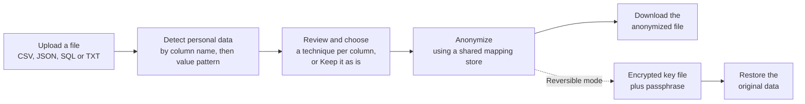
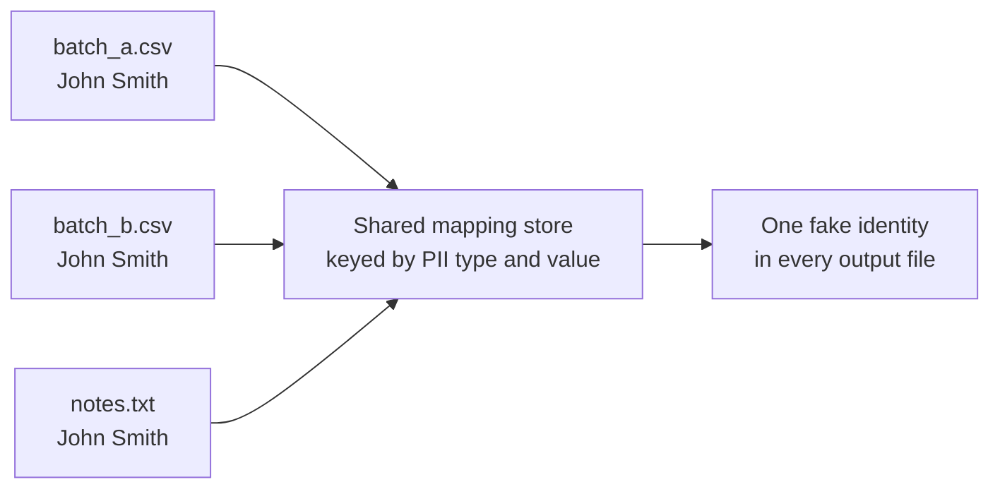
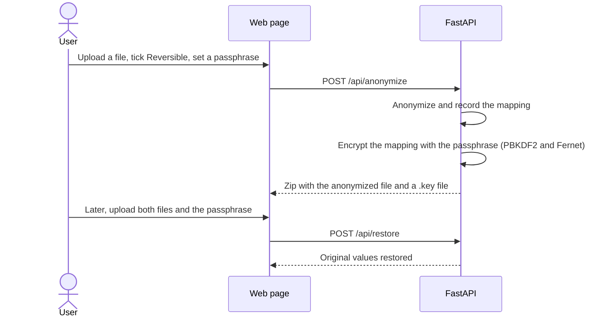
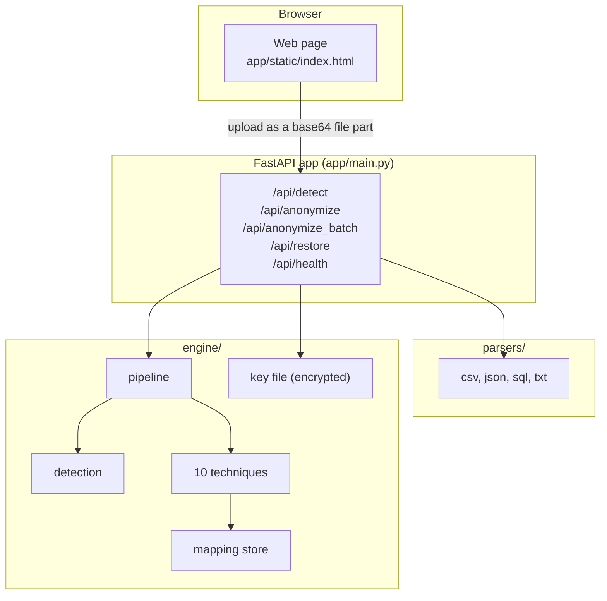

# Data Anonymizer

ICS 499 Capstone — Team 13 (Chris Nhul, Sophie Tony-Uduhirinwa)

Extends the Assignment 2 SQL anonymizer into a full application: upload a
dataset, PII is auto-detected, each column gets a selectable anonymization
technique, and the anonymized file downloads back. Reversible mode produces
an encrypted key file (PBKDF2 + Fernet) that restores the original data
exactly — without the key file and passphrase, originals are unrecoverable.

**Live app:** https://data-anonymizer-g90k.onrender.com (free tier — hit
`/api/health` first to wake it before a demo)

## How it works



## Stack

Python 3.10+ · FastAPI · Faker · cryptography · pytest. Deployed on Render,
auto-deploy from `main`. 182 automated tests.

## Run locally

```bash
python -m venv .venv
source .venv/bin/activate        # Windows: .venv\Scripts\activate
pip install -r requirements.txt  # re-run after every pull
pytest                           # all tests should pass
uvicorn app.main:app --reload    # then open http://127.0.0.1:8000
```

Try it with `samples/customers.csv` (single table) or `samples/company.sql`
(multi-table, shows cross-table consistency).

## Capabilities

- **Formats:** CSV, JSON, SQL (multi-table, INSERTs only — DROP/CREATE/
  UPDATE/DELETE pass through), TXT (pattern-detectable PII in free text)
- **PII types (9):** name, email, phone, address, dob, zip, ssn, ip, card —
  detected by column name with a value-pattern fallback; the user can
  override the technique per column
- **Techniques (10):** substitution, pseudonymization, hashing,
  format-preserving masking (Luhn-valid cards), nulling, partial masking,
  generalization, shuffling, perturbation, synthetic — see
  `DESIGN_AND_TESTING.md` for why these ten and not the other four
- **Reversible mode:** substitution, pseudonymization, hashing, and
  format-preserving masking are store-backed; anonymizing with a passphrase
  yields a zip with the anonymized file + encrypted `.key` file, and
  `/api/restore` brings the originals back exactly
- **Batch:** up to 20 mixed-format files in one run (Batch tab /
  `/api/anonymize_batch`) with one shared mapping store — the same person
  gets the same fake across every file — and one key file in reversible mode
- **User control:** per-column technique override, including keep (don't
  anonymize) for correcting detection
- **Measured limits:** benchmarks and a live load test in `SCALABILITY.md`
  (~5-6k rows/sec fully-distinct, 1M realistic rows ~15s, 20 concurrent
  users without failures on free-tier hosting)
- **Consistency:** the same original value maps to the same fake, within a
  file and across SQL tables; runs are reproducible per project seed

## Techniques at a glance

| Technique | What it does | Example | Reversible |
|---|---|---|---|
| Substitution | Replaces the value with a realistic fake of the same type | Daniel Carter → Brittney Cameron | Yes |
| Pseudonymization | Consistent fake value: same input, same output | Daniel Carter → Brittney Cameron (every time) | Yes |
| Hashing | One-way scrambled code | daniel.carter@example.com → 9f86d08188... | Yes |
| Format-preserving | Same shape, new value | 4111111111111111 → 4927123498761112 | Yes |
| Partial masking | Hides part of the value | j.smith@gmail.com → j*****@gmail.com | No |
| Generalization | Reduces precision | 1990-05-15 → 1990 | No |
| Nulling | Removes the value | 123-45-6789 → (blank) | No |
| Shuffling | Mixes a column's values between rows | City values swapped between records | No |
| Perturbation | Nudges numbers slightly | Age 37 → 38 | No |
| Synthetic | Generates a brand-new artificial value | Emma Williams, emma.williams@test.com | No |

"Reversible" means the original can be restored with the key file and the
passphrase. The other six remove or replace information on purpose, and the
app refuses to run them in reversible mode.

## Consistency across files



## Reversible mode



## Layout

```
app/        FastAPI app + web UI            (API: Chris; UI: Sophie)
engine/     detection, mapping, pipeline,
            key file, techniques            (architecture: Chris;
                                             nulling/masking/generalization:
                                             Sophie)
parsers/    CSV, JSON, SQL, TXT             (owner: Sophie)
tests/      pytest suite                    (shared)
samples/    demo datasets
```

### Architecture



## Design decisions

- Consistency mapping is keyed by (PII type, original value), and
  determinism is seeded (HMAC-derived per-value seeds — reproducible with
  the seed, not dictionary-attackable without it).
- Files travel to the API base64-encoded: the hosting edge firewall blocks
  raw request bodies that pattern-match SQL injection, which legitimate
  .sql uploads do.
- Fail closed: a value a technique can't handle comes back fully masked,
  never raw.
- The user's edited detection plan is authoritative: columns removed from
  it are left untouched.

## Known limitations

- Restored SQL is equivalent, not byte-identical: INSERT statements are
  rebuilt and comments are not carried into output files.
- UPDATE/DELETE statements pass through verbatim, so PII inside their
  literals is not anonymized (same scope as Assignment 2; documented
  v1 boundary).
- The JSON parser takes headers from the first record; fields that first
  appear in later records are dropped.
- Generalization leaves street addresses unchanged; use substitution,
  nulling, or partial masking for address columns.
- Column-name detection is a heuristic: thing-names (product_name etc.) are
  suppressed, and remaining false positives are handled by the per-column
  override.

## Docs

- `SCOPE_PROPOSAL.md` — agreed scope (FP2)
- `FP_iteration_plan.md` — week-by-week plan (living document)
- `DESIGN_AND_TESTING.md` — design, testing evidence, technique scope
  rationale
- `SCALABILITY.md` — measured benchmarks, load test, limits, production path
- `AI_DATA_PROMPT.md` — verified prompts for generating compatible test
  data with AI tools